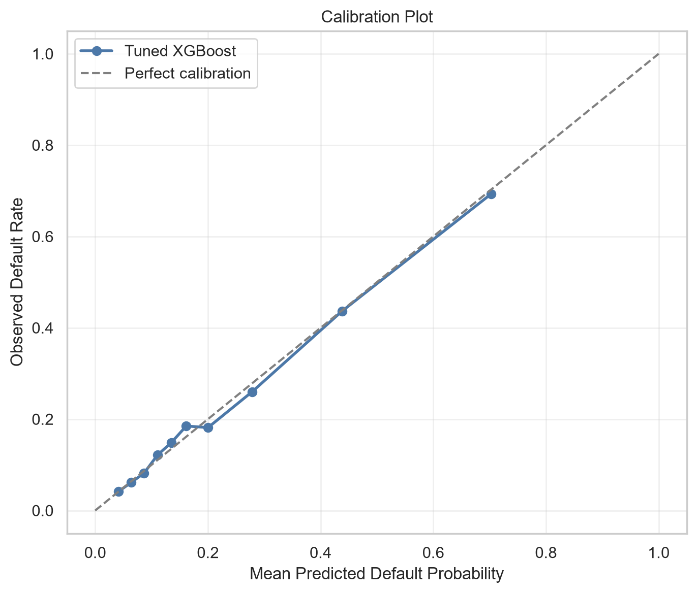
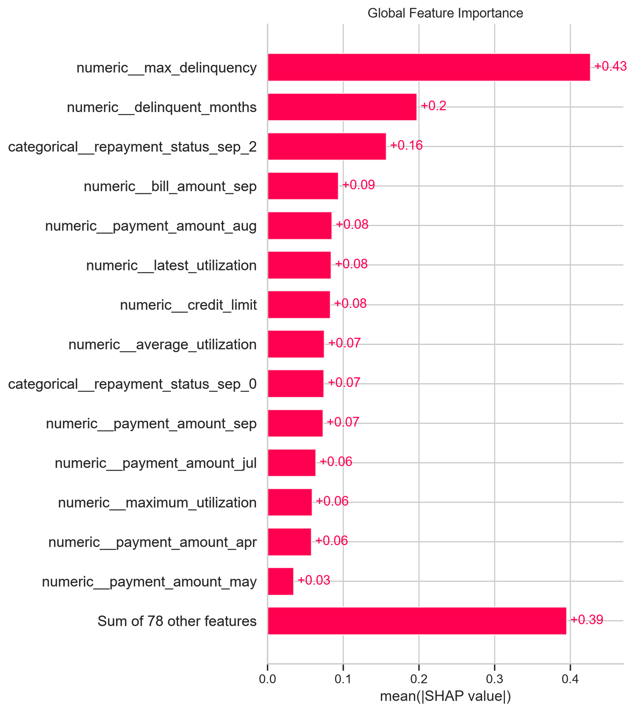

# Interpretable Credit Default Risk and Model Validation

An end-to-end credit-risk analytics project that compares an interpretable
logistic-regression baseline with a tuned XGBoost challenger, selects a
cost-sensitive operating threshold using out-of-fold predictions, and evaluates
the final model on an untouched holdout sample.

The project emphasizes the parts of model development that matter in risk and
model-validation roles: leakage control, class-imbalance-aware metrics,
threshold economics, calibration, explainability, subgroup diagnostics, and
clear governance limitations.

> **Scope:** portfolio and educational demonstration only. This model is not
> approved for real lending, underwriting, pricing, or adverse-action decisions.

## Live demo

[](https://credit-risk-model-validation-mu92yhuqiqsyi6hjtwrswb.streamlit.app/)

Explore the deployed
[Credit Risk Model Validation Dashboard](https://credit-risk-model-validation-mu92yhuqiqsyi6hjtwrswb.streamlit.app/),
including the validated `0.19` operating threshold, cost scenarios, calibration,
SHAP importance, and subgroup diagnostics.

## Business question

Can the next-month probability of credit-card default be estimated accurately
enough to rank customers by risk, and how should the decision threshold change
when a missed default is more costly than an unnecessary high-risk review?

## Validation design

- 30,000 customer records from the UCI *Default of Credit Card Clients* dataset.
- Stratified 80/20 development–holdout split with `random_state=42`.
- Exploratory analysis, feature design, model selection, and threshold selection
  use the development sample only.
- Five-fold stratified cross-validation estimates development performance.
- The operating threshold is selected from development out-of-fold probabilities.
- The holdout sample is scored once for final performance assessment.
- SHAP explanations preserve the exact sparse representation used by the fitted
  XGBoost pipeline.

## Key results

### Model comparison on the development sample

| Model | ROC-AUC | PR-AUC | Recall at 0.50 |
|---|---:|---:|---:|
| Logistic regression | 0.7726 | 0.5430 | 0.3601 |
| Baseline XGBoost | 0.7866 | 0.5606 | 0.3716 |
| Tuned XGBoost | 0.7878 | 0.5656 | 0.3714 |

The tuned cross-validation metrics are model-development estimates rather than
an independent performance claim because hyperparameter selection and summary
cross-validation use the same development sample.

### Final untouched holdout performance

| Metric | Result |
|---|---:|
| ROC-AUC | 0.7835 |
| PR-AUC | 0.5621 |
| KS statistic | 0.4341 |
| Brier score | 0.1341 |
| Binned expected calibration error | 0.0104 |
| Brier skill score | 0.2218 |

### Cost-sensitive operating point

The illustrative cost ratio assigns a cost of 5 to a false negative and 1 to a
false positive. The development out-of-fold cost minimum occurred at a threshold
of `0.19`.

| Holdout result | Threshold 0.50 | Threshold 0.19 |
|---|---:|---:|
| Recall | 36.55% | 68.43% |
| Precision | 66.99% | 41.01% |
| Specificity | 94.89% | 72.05% |
| Balanced accuracy | 65.72% | 70.24% |
| Predicted high-risk rate | 12.07% | 36.90% |
| False negatives | 842 | 419 |
| False positives | 239 | 1,306 |
| Illustrative error cost | 4,449 | 3,401 |

The selected threshold reduced the illustrative holdout error cost by 23.6%,
mainly by detecting substantially more default customers. Real deployment would
require institution-specific loss severity, investigation capacity, policy, and
regulatory constraints.

## Analytical workflow

1. Validate missing values, identifiers, category codes, duplicates, and
   numerical ranges.
2. Preserve an untouched stratified holdout sample.
3. Explore delinquency persistence, latest repayment status, and utilization.
4. Engineer five interpretable behavioural features.
5. Compare logistic regression and XGBoost with consistent cross-validation.
6. Tune XGBoost for average precision.
7. Select a cost-sensitive threshold from out-of-fold probabilities.
8. Evaluate discrimination, calibration, and operating performance on holdout.
9. Explain predictions with model-faithful sparse SHAP values.
10. Compare a challenger without demographic variables and audit subgroup
    performance descriptively.

## Explainability and governance findings

- Delinquency severity and persistence were the dominant risk signals.
- Latest repayment status, utilization, credit limit, and payment amounts also
  contributed to predictions.
- Removing sex, education, and marital status reduced development ROC-AUC by
  only 0.0013 and PR-AUC by 0.0027.
- A restricted challenger without demographic variables is preferable for
  future governance consideration, but it still requires independent holdout
  validation.
- Small demographic groups have high uncertainty. Subgroup differences are
  descriptive and are not interpreted as causality or a complete legal-fairness
  assessment.





## Interactive dashboard

The [live Streamlit dashboard](https://credit-risk-model-validation-mu92yhuqiqsyi6hjtwrswb.streamlit.app/) provides:

- holdout ROC-AUC, PR-AUC, KS, and Brier score;
- a threshold and cost scenario simulator;
- confusion matrix and error-cost curves;
- precision, recall, and specificity trade-offs;
- calibration and global SHAP visualizations;
- demographic-feature sensitivity and subgroup audits.

Run it from the project root:

```powershell
.\.venv\Scripts\python.exe -m streamlit run app.py
```

The sidebar is a scenario-analysis interface. It does not re-select the
validated threshold from the holdout sample.

## Repository structure

```text
credit-risk-model-validation/
├── app.py
├── credit_risk_model_validation.ipynb
├── README.md
├── MODEL_CARD.md
├── requirements.txt
├── .gitignore
├── models/
│   ├── model_metadata.json
│   └── tuned_xgboost_full_model.joblib
├── reports/
│   └── tables/
│       ├── test_predictions.csv
│       ├── test_ranking_metrics.csv
│       ├── threshold_comparison.csv
│       ├── calibration_summary.csv
│       ├── shap_feature_importance.csv
│       └── subgroup and model-comparison tables
└── figures/
    ├── calibration_plot.png
    ├── shap_global_importance.png
    └── shap_summary.png
```

## Reproduce locally on Windows

```powershell
python -m venv .venv
.\.venv\Scripts\Activate.ps1
python -m pip install --upgrade pip
pip install -r requirements.txt
python -m ipykernel install --user `
    --name credit-risk `
    --display-name "Python (credit-risk)"
python -m jupyter lab
```

Open `credit_risk_model_validation.ipynb`, choose `Python (credit-risk)`, and
run all cells. The notebook fetches the public dataset, rebuilds the validation
results, fits the final pipeline, and exports the files used by the dashboard.

## Limitations

- The data represent Taiwanese credit-card customers from 2005 and may not
  reflect current portfolios, policies, macroeconomic conditions, or markets.
- A random holdout does not test temporal drift; production validation requires
  out-of-time and external samples.
- The tuned development cross-validation estimate is not nested and may be
  mildly optimistic. The untouched holdout is the final reported benchmark.
- Cost assumptions are illustrative and omit exposure, recovery, review cost,
  and capacity constraints.
- Predicted default probability is an association based on observed data, not a
  causal estimate.

## Data source

UCI Machine Learning Repository, dataset 350, *Default of Credit Card Clients*.
The dataset originates from Yeh and Lien's study of default prediction among
credit-card clients in Taiwan.

See [MODEL_CARD.md](MODEL_CARD.md) for intended use, risks, validation evidence,
and governance constraints.
